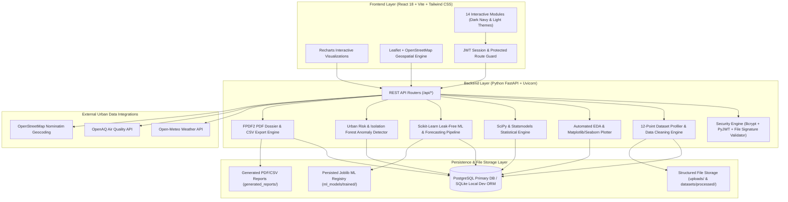

# NagarNexus System Architecture & Engineering Specification

> **Project Tagline**: *"Turning Urban Data Into Intelligent Decisions."*

## 1. High-Level System Architecture Diagram

## 2. Unified Data Flow Pipeline

```mermaid
flowchart LR
    A["External API / User CSV-XLSX Upload"] --> B["Extension, MIME & Binary Signature Validation"]
    B --> C["12-Point Automated Dataset Profiler"]
    C --> D["User-Controlled Data Cleaning Engine"]
    D --> E["PostgreSQL / SQLAlchemy Normalized Storage"]
    E --> F["Automated EDA & SciPy Statistical Testing"]
    F --> G["Leak-Free Scikit-Learn ML Training & Evaluation"]
    G --> H["Dashboard, Risk Alerts, AI Insights & PDF Reports"]
```

## 3. Frontend Architecture (`frontend/`)

- **Framework**: React 18 with Vite 5 and React Router v6.
- **Styling**: Tailwind CSS with custom dark navy palette (`#060b19`, `#0b132b`) and one-click Light Mode toggle.
- **State & Authentication**: `AuthContext.jsx` manages JWT tokens, user profile state, active dataset selection, and theme persistence.
- **14 Connected Modules**:
  1. `OverviewDashboard.jsx` (`/`)
  2. `LocationIntelligence.jsx` (`/locations`)
  3. `DatasetExplorer.jsx` (`/datasets`)
  4. `DataCleaning.jsx` (`/cleaning`)
  5. `ExploratoryDataAnalysis.jsx` (`/eda`)
  6. `StatisticalAnalysis.jsx` (`/statistics`)
  7. `MachineLearningLab.jsx` (`/ml-lab`)
  8. `PredictiveAnalytics.jsx` (`/predictions`)
  9. `RiskDetection.jsx` (`/risk`)
  10. `LocationComparison.jsx` (`/comparison`)
  11. `AIInsights.jsx` (`/insights`)
  12. `ReportCenter.jsx` (`/reports`)
  13. `UserProfile.jsx` (`/profile`)
  14. `SettingsPage.jsx` (`/settings`)

## 4. Backend Architecture (`backend/`)

- **API Framework**: FastAPI with Pydantic v2 validation schemas and automatic OpenAPI/Swagger documentation at `/docs`.
- **Database ORM**: SQLAlchemy 2.0 with Alembic migrations (`backend/alembic/`).
- **Security Controls**:
  - Passwords hashed using `bcrypt` (12 rounds).
  - Signed `HS256` JWT tokens via `PyJWT`.
  - File upload validation (`app/utils/file_security.py`) inspects file extensions, MIME types, file size limits, and binary headers (`PK\x03\x04` for XLSX, null-byte rejection for CSV) and enforces path traversal protection.
  - Multi-tenant ownership isolation ensures users can only view, modify, or delete their own private datasets, models, and reports.

