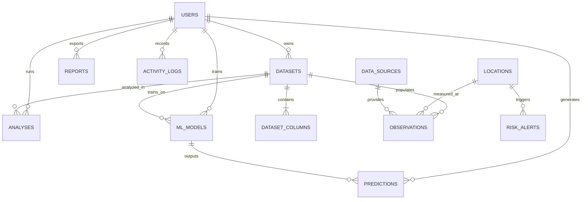

# NagarNexus Normalized Database Schema

NagarNexus uses **SQLAlchemy 2.0 ORM** and **Alembic** migrations supporting **PostgreSQL** as the primary production database and **SQLite** as a zero-configuration local development alternative.

> **Storage Rule**: Large raw datasets are stored as structured files on disk (`backend/uploads/`, `datasets/processed/`, `datasets/sample/`), never inside ordinary database text fields. The database stores normalized metadata, column schemas, telemetry observations, and file paths.

## Entity-Relationship Diagram

## Tables Specification (12 Normalized Tables)

1. **`users`**: `id` (PK), `full_name`, `email` (Unique, Indexed), `password_hash`, `role`, `organization`, `preferred_city`, `created_at`, `updated_at`.
2. **`datasets`**: `id` (PK), `user_id` (FK -> `users.id`), `name`, `description`, `file_path`, `processed_file_path`, `file_type`, `file_size`, `row_count`, `column_count`, `source_type`, `is_public`, `quality_score`, `profile_json`, `upload_timestamp`, `updated_at`, `processing_status`.
3. **`dataset_columns`**: `id` (PK), `dataset_id` (FK -> `datasets.id`), `column_name`, `data_type`, `raw_dtype`, `missing_count`, `unique_count`, `sample_values`.
4. **`locations`**: `id` (PK), `name` (Indexed), `city` (Indexed), `state`, `country`, `latitude`, `longitude`, `geographical_resolution`, `elevation_m`, `zone_type`, `created_at`, `updated_at`.
5. **`data_sources`**: `id` (PK), `source_name`, `source_url`, `source_type`, `retrieved_at`, `attribution`, `created_at`.
6. **`observations`**: `id` (PK), `location_id` (FK -> `locations.id`), `dataset_id` (FK -> `datasets.id`), `indicator` (Indexed), `value`, `unit`, `observed_at` (Indexed), `source_id` (FK -> `data_sources.id`), `created_at`.
7. **`analyses`**: `id` (PK), `user_id` (FK -> `users.id`), `dataset_id` (FK -> `datasets.id`), `analysis_type`, `result_json`, `created_at`, `updated_at`.
8. **`ml_models`**: `id` (PK), `user_id` (FK -> `users.id`), `dataset_id` (FK -> `datasets.id`), `model_name`, `model_type`, `algorithm`, `model_version`, `feature_columns`, `target_column`, `hyperparameters_json`, `metrics_json`, `model_path`, `is_public`, `created_at`, `updated_at`.
9. **`predictions`**: `id` (PK), `model_id` (FK -> `ml_models.id`), `user_id` (FK -> `users.id`), `category`, `location_id` (FK -> `locations.id`), `input_json`, `predicted_value`, `numeric_prediction`, `actual_value`, `confidence_metadata`, `created_at`.
10. **`risk_alerts`**: `id` (PK), `location_id` (FK -> `locations.id`), `dataset_id` (FK -> `datasets.id`), `risk_category`, `indicator`, `risk_level` (Indexed), `measured_value`, `threshold`, `unit`, `explanation`, `suggested_action`, `data_source`, `threshold_type`, `created_at`.
11. **`reports`**: `id` (PK), `user_id` (FK -> `users.id`), `dataset_id` (FK -> `datasets.id`), `title`, `report_type`, `file_path`, `csv_file_path`, `summary_json`, `created_at`.
12. **`activity_logs`**: `id` (PK), `user_id` (FK -> `users.id`), `activity_type` (Indexed), `description`, `created_at` (Indexed).

